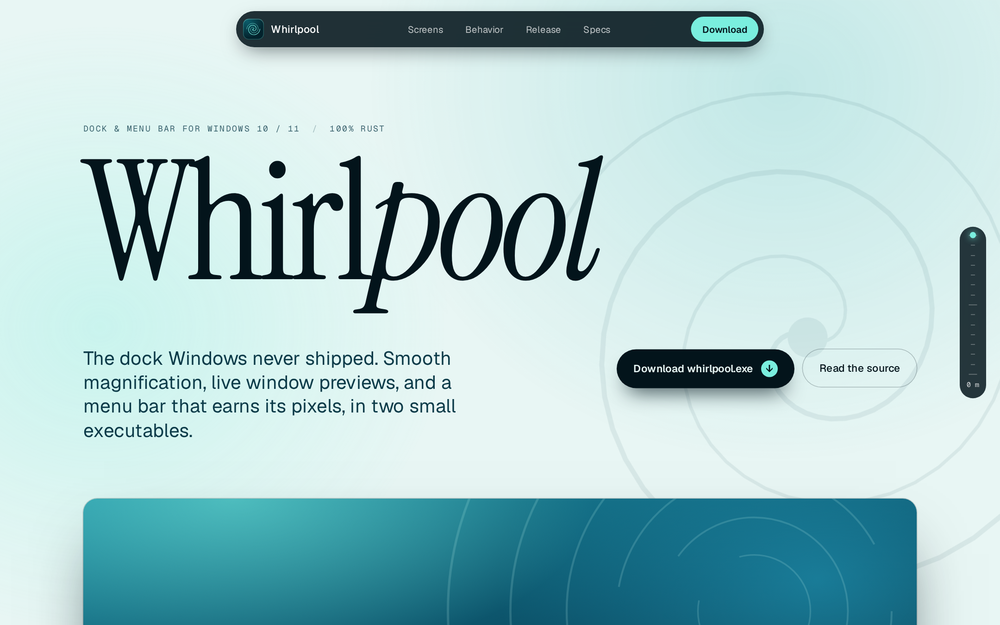
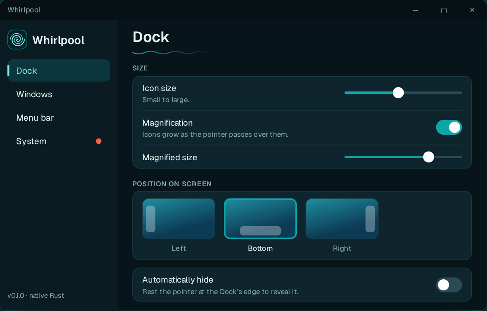

<p align="center">
  
</p>

<h1 align="center">Whirlpool</h1>

<p align="center">
  A dock and menu bar for Windows 10 and 11, written entirely in Rust.<br>
  No web view. No runtime. Two small executables.
</p>



## What it is

| Program | Role |
| --- | --- |
| `whirlpool.exe` | The dock and optional top menu bar (Win32 + DirectComposition + Direct2D) |
| `whirlpool-settings.exe` | Native settings window (egui/glow). Edits `config.json`, then tells the dock to reload |

- **Glass dock** with spring-driven, pointer-based magnification; pin, group, reorder, recent apps.
- **Live window previews** with titles, **Genie minimize** (three speeds), minimized-window thumbnails.
- **Menu bar** with clock, network, volume, battery, input language, tray, now-playing and an AI plan-usage island (notch or bubble).
- **Drag and drop** onto apps, Downloads and the Recycle Bin; shortcuts-folder menu; auto-hide on any edge.
- **Settings** in English, Español and Français, light and dark, with previews drawn over your own wallpaper.
- **A watchdog** restores the Windows taskbar if the dock exits unexpectedly (`whirlpool.exe --restore` does it by hand).



## Install

Windows 10 (1903+) or Windows 11, 64-bit.

**One line, per-user, no admin:**

```powershell
irm https://raw.githubusercontent.com/prashantchataut/whirlpool/main/scripts/install.ps1 | iex
```

**Or manually:** download `whirlpool.exe` and `whirlpool-settings.exe` from [Releases](https://github.com/prashantchataut/whirlpool/releases/latest), keep them in one folder, run `whirlpool.exe`. The binaries are unsigned, so SmartScreen may ask: **More info → Run anyway**. Checksums are in `SHA256SUMS.txt`.

If the dock ever misbehaves: `whirlpool.exe --restore` brings the Windows taskbar back.

## Build from source

Requires Rust (MSVC toolchain) and the Visual Studio C++ build tools.

```powershell
cargo build --release -p whirlpool -p whirlpool-settings
# target\release\whirlpool.exe and target\release\whirlpool-settings.exe
cargo fmt --all -- --check
cargo test --workspace
```

## Layout

| Path | Purpose |
| --- | --- |
| `apps/dock` | Native Windows dock and menu bar |
| `apps/settings` | Native settings window (egui) |
| `crates/whirlpool-core` | Platform-independent layout and animation logic |
| `crates/whirlpool-shell` | Windows shell integration |
| `crates/whirlpool-config` | Shared settings and persistence |
| `site/` | The project website (Vite + React, deployed to GitHub Pages) |
| `docs/` | Design notes, theme reference, upstream changelog |

## Privacy

No telemetry. Optional network use: the settings window asks GitHub for the latest release when it opens (turn off with *Check for updates automatically*), and the AI-usage island asks the provider you are already signed in to for plan limits (turn off in Menu bar settings).

## Credits and license

Whirlpool is a fork of [Muelle Native](https://github.com/prashantchataut/muelle-native), itself a fork of [crafter-station/Muelle](https://github.com/crafter-station/Muelle). MIT. Original work © Muelle contributors; changes in this fork are released under the same license. The pre-fork history is kept in [`docs/upstream/CHANGELOG-muelle.md`](docs/upstream/CHANGELOG-muelle.md).
