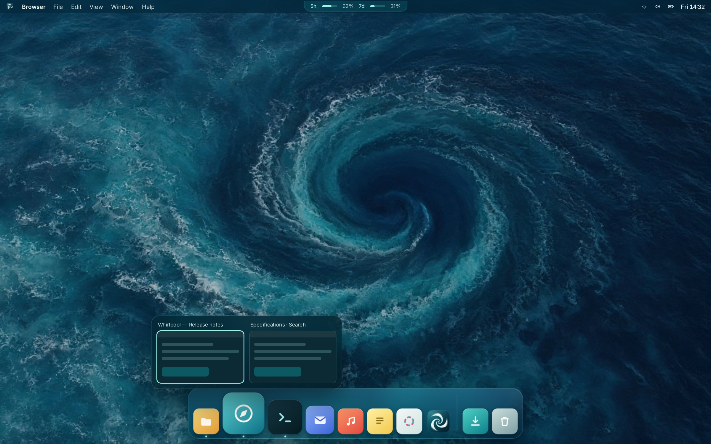
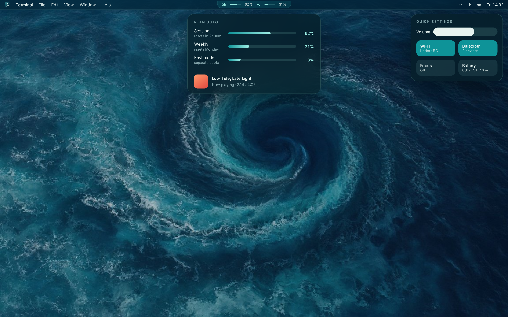
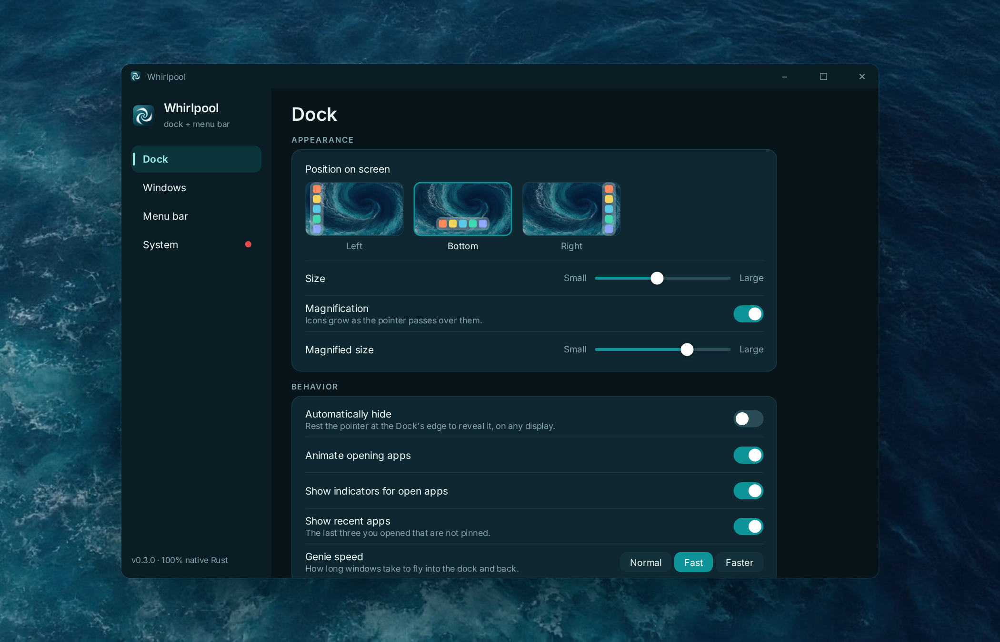
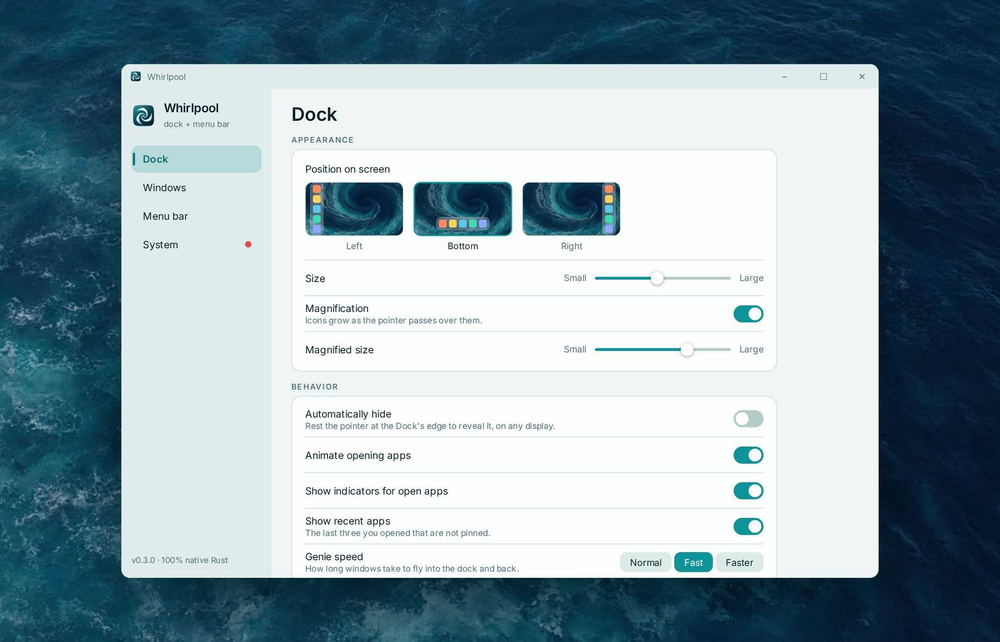

<p align="center"></p>

<h1 align="center">Whirlpool</h1>

<p align="center">A dock and menu bar for Windows 10 and 11, written entirely in Rust.<br>
Two plain executables. No web view, no runtime, no telemetry.</p>

<p align="center"><a href="https://github.com/prashantchataut/whirlpool/releases/latest"><b>Download</b></a> · <a href="https://prashantchataut.github.io/whirlpool/">Website</a> · <a href="docs/ARCHITECTURE.md">Architecture</a> · <a href="CHANGELOG.md">Changelog</a></p>



> **About the pictures.** The screens in this README and on the website are design renders drawn from the app's own palette, labels and layout (see [`site/renders`](site/renders)). They are not captures of a running Windows session. The dock itself needs Windows to run.

## What it is

Whirlpool is a fork of [Muelle Native](https://github.com/prashantchataut/muelle-native), itself a fork of [crafter-station/Muelle](https://github.com/crafter-station/Muelle) (MIT). The dock was already native Direct2D/DirectComposition Rust. Whirlpool keeps every feature and adds an ocean identity, a rebuilt settings window and clearer docs.

| Program | What it is |
| --- | --- |
| `whirlpool.exe` | The dock and optional top menu bar (Win32, DirectComposition, Direct2D, DirectWrite) |
| `whirlpool-settings.exe` | Native settings window (egui). Edits the same `config.json` and tells the dock to reload |

## What changed from Muelle Native

- **New name and theme.** Abyss (dark) and Foam (light) palettes, a tide-teal accent, a vortex mark and a regenerated icon. The dock glass, labels, menus, group glow and active-app indicator are tinted to match.
- **Rebuilt settings window.** Inter typeface embedded, semibold weights, a sidebar with a leading tide mark, themed controls (sliders, combo boxes, buttons) instead of egui defaults, and cards with more breathing room.
- **Nothing lost on upgrade.** On first run Whirlpool moves your `%APPDATA%\Muelle` (or older `WinDock`) folder to `%APPDATA%\Whirlpool`, keeping pins, groups and preferences.
- **Docs.** [Architecture](docs/ARCHITECTURE.md), [contributing](CONTRIBUTING.md), a regenerable [icon script](scripts/make_icon.py), and a website that deploys from [`site/`](site).
- **Pipelines.** Release builds both programs on Windows, publishes `.exe`, `.zip`, `install.ps1`, `SHA256SUMS.txt` and the changelog section as release notes. The website deploys to GitHub Pages.

## Features

- Glass dock with cursor-based magnification, pinning, grouping, reordering and recent apps.
- Live window previews, Genie minimize effect (three speeds), minimized-window thumbnails.
- Menu bar with clock, network, volume, battery, input language, tray icons, now-playing and an AI plan-usage island.
- Drag and drop onto apps, Downloads and the Recycle Bin; shortcuts folder menu; optional auto-hide.
- Settings in English, Spanish and French, light and dark, with previews drawn over your wallpaper.
- A watchdog restores the Windows taskbar if the dock exits unexpectedly.

| Menu bar, island and quick settings | Settings, dark (Abyss) | Settings, light (Foam) |
| --- | --- | --- |
|  |  |  |

## Install

Windows 10 (1903+) or Windows 11, 64-bit.

**One line (no admin, per-user):**

```powershell
irm https://raw.githubusercontent.com/prashantchataut/whirlpool/main/scripts/install.ps1 | iex
```

**Or manually:** download `whirlpool.exe` and `whirlpool-settings.exe` from [Releases](https://github.com/prashantchataut/whirlpool/releases/latest), keep them in the same folder and run `whirlpool.exe`. The binaries are unsigned, so SmartScreen may ask you to choose **More info, then Run anyway**. Checksums are in `SHA256SUMS.txt`.

If the dock ever misbehaves, `whirlpool.exe --restore` brings the Windows taskbar back.

## Build from source

Requires Rust (MSVC toolchain) and the Visual Studio C++ build tools.

```powershell
cargo build --release -p whirlpool -p whirlpool-settings
# target\release\whirlpool.exe and target\release\whirlpool-settings.exe

cargo fmt --all -- --check
cargo test --workspace
```

Cross-compiling from Linux works for checking and for a GNU-target build: `rustup target add x86_64-pc-windows-gnu`, install `gcc-mingw-w64-x86-64`, then `cargo build --release --target x86_64-pc-windows-gnu -p whirlpool -p whirlpool-settings`. Release builds for the MSVC target come from CI.

## Layout

| Path | Purpose |
| --- | --- |
| `apps/dock` | Native Windows dock and menu bar |
| `apps/settings` | Native settings window (egui) |
| `crates/whirlpool-core` | Platform-independent layout and animation logic |
| `crates/whirlpool-shell` | Windows shell integration |
| `crates/whirlpool-config` | Shared settings and persistence |
| `site` | The website and the HTML sources of the renders |
| `scripts` | Installer, icon generator, measurement helpers |

## Privacy

No telemetry. Optional network use: the settings window asks GitHub for the latest release when you open it (turn off with *Check for updates automatically*), and the dock's AI-usage island asks the provider you are already signed in to for plan limits (turn off in Menu bar settings).

## License

MIT. Original work © Muelle contributors; changes in this fork are released under the same license. The Inter typeface in the settings window is under the SIL Open Font License ([`apps/settings/assets/fonts/Inter-OFL.txt`](apps/settings/assets/fonts/Inter-OFL.txt)).
