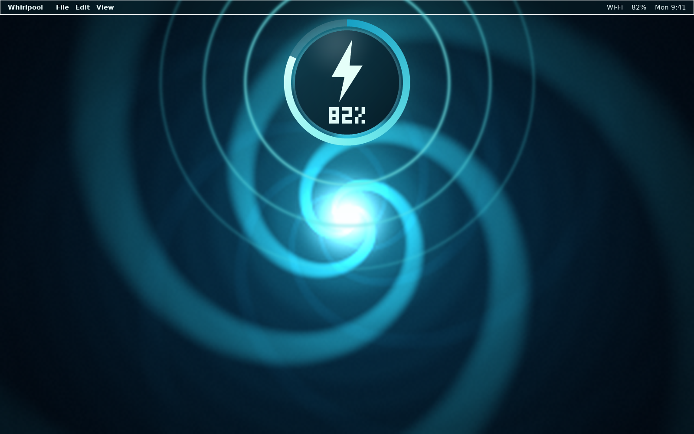
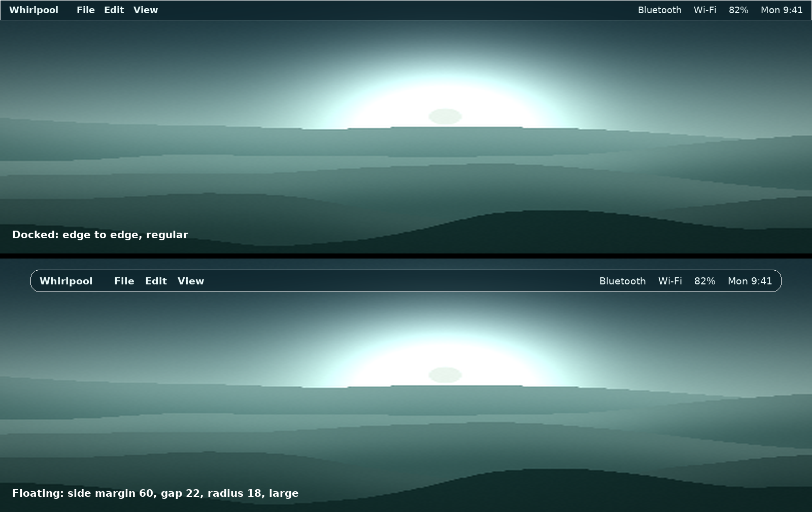
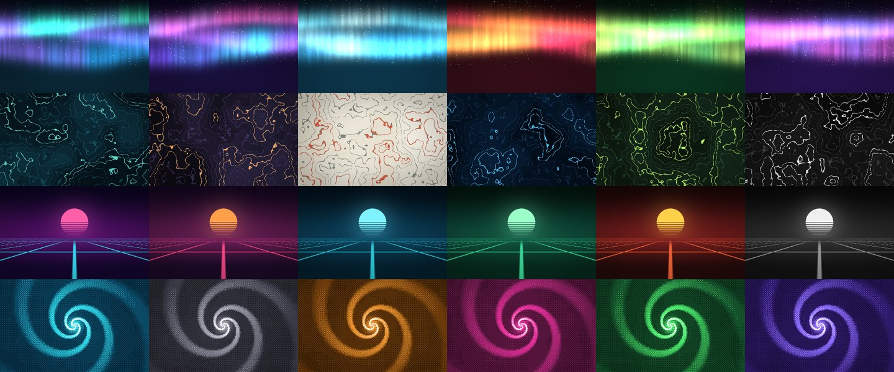
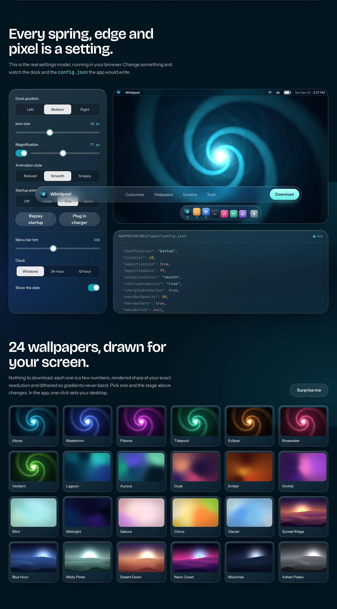
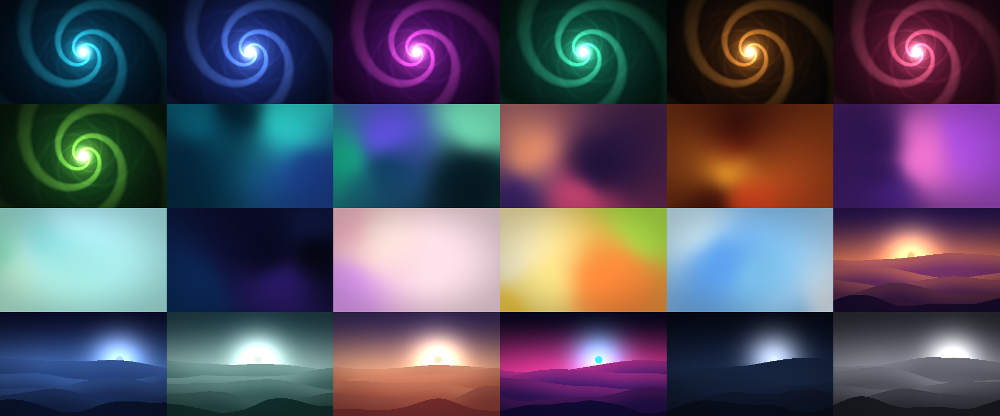
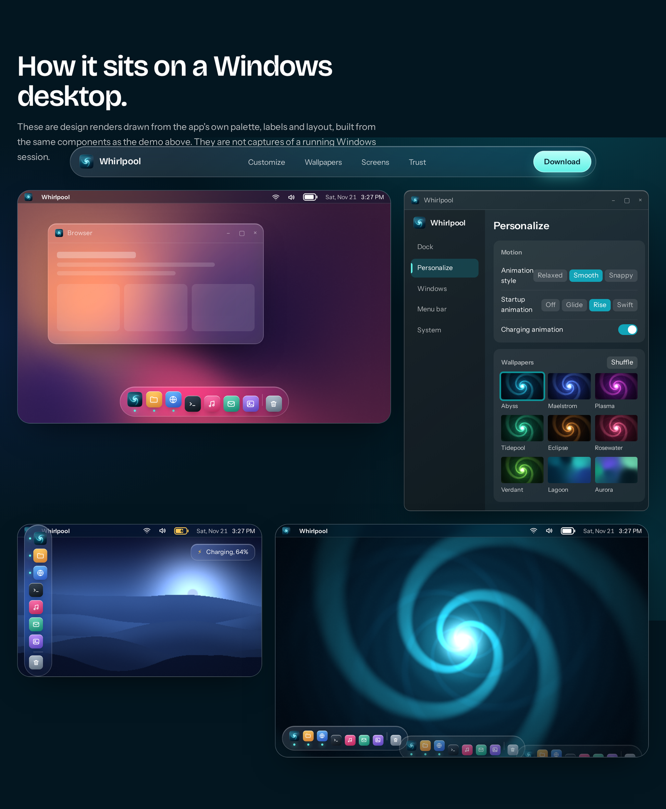

<p align="center">
  
</p>

<h1 align="center">Whirlpool</h1>

<p align="center">
  <b>A dock that moves like water.</b><br>
  A magnifying dock and a customizable menu bar for Windows 10 and 11.<br>
  One small native Rust program, settings included. No web view. No runtime. It sleeps when you do.
</p>

<p align="center">
  <a href="https://github.com/prashantchataut/whirlpool/releases/latest"><b>Download</b></a> ·
  <a href="https://prashantchataut.github.io/whirlpool/">Website</a> ·
  <a href="docs/TRUST.md">Trust &amp; verification</a> ·
  <a href="CHANGELOG.md">Changelog</a>
</p>

<p align="center">
  
</p>

> **About the images.** Everything under `docs/previews/` is a **design render** drawn from the app's own palette, labels and
> layout (the website builds them from the same components as its live demo). They are not captures of a running Windows
> session. Please run the release and compare.

## New in 2.0

<p align="center">
  
</p>

- **One program.** Settings is built into `whirlpool.exe` (`whirlpool.exe --settings`). Right-click the dock, use the Start menu entry, or start Whirlpool again while it runs. The old second download is gone, and Settings now exits completely when you close it.
- **A real installer.** `Whirlpool-Setup.exe`: per user, no administrator rights, Start menu entries, optional start with Windows, an entry in Apps and Features, and a clean uninstall that gives the taskbar back.
- **The right logo everywhere.** The executable, the installer, the Settings window, its title bar and its sidebar all use the same mark. The icon file was rebuilt in the most compatible format.
- **New charging animation.** A glass medallion drops in under the menu bar, its ring fills to your real battery level, a bolt pulses and rings of water spread out. *Surge* or the calmer *Halo*, or off. The old mascot no longer appears for the charger.
- **Menu bar look and position.** Docked or floating (side margin, top gap, corner radius), compact, regular or large.
- **54 wallpapers.** Aurora, contour maps, a synthwave grid and the dithered vortex join the originals.

<p align="center">
  
</p>
<p align="center">
  
</p>

> The charging and menu bar images are **design renders** (`scripts/render_v2.py`) that use the app's own maths and palette.
> The wallpaper sheet is the app's real renderer. None is a capture of a running Windows session.

## What you get

| | |
| --- | --- |
| **Glass dock** | Spring magnification, pins, groups, recents, live window previews, Genie minimize, drag and drop, auto-hide on any edge. |
| **Menu bar** | Clock, network, volume, battery, input language, tray, now playing and an AI plan-usage island. Tint strength, date and 12/24-hour clock are yours to set. |
| **Wallpapers** | 24 procedural wallpapers (vortex, mesh, horizon) drawn at the exact resolution of your screen, plus Shuffle. Nothing is downloaded. |
| **Motion** | Animation style (Relaxed, Smooth, Snappy), a startup animation (Off, Glide, Rise, Swift), a dock that sinks away when you quit, and a charging animation you can turn off on its own. |
| **Your taskbar, hidden for real** | The Windows taskbar is auto-hidden, made transparent and click-through, given an empty window region, and re-checked every few seconds. `whirlpool.exe --restore` always brings it back. |
| **Settings that fit** | A native window that sizes itself to your monitor and scale, in English, Español and Français, light and dark. |

<p align="center">
  
</p>

### Wallpapers

<p align="center">
  
</p>

### Screens

<p align="center">
  
</p>

## Install

Windows 10 (1903+) or Windows 11, 64-bit.

**Setup (recommended).** Download `Whirlpool-Setup.exe` from [Releases](https://github.com/prashantchataut/whirlpool/releases/latest) and run it. No administrator rights.

**One line, per user, no admin.** The script verifies the SHA-256 of the file before it installs anything:

```powershell
irm https://raw.githubusercontent.com/prashantchataut/whirlpool/main/scripts/install.ps1 | iex
```

**Portable.** Download `whirlpool.exe` (or the zip) and run it. Open settings from the dock's right-click menu, or run `whirlpool.exe --settings`.

### Windows warns me. Is it safe?

A brand-new open-source app has no signature and no download reputation yet, so SmartScreen says *unknown publisher*.
That means unknown, not malicious. Here is how to check, and what we do about it ([full notes](docs/TRUST.md)):

```powershell
Get-FileHash .\whirlpool.exe -Algorithm SHA256                          # compare with SHA256SUMS.txt
gh attestation verify .\whirlpool.exe --repo prashantchataut/whirlpool  # proves which workflow and commit built it
```

- Releases are built by GitHub Actions from a tagged commit, with a signed build-provenance attestation and `SHA256SUMS.txt`.
- Both executables carry full version information and ask for **no administrator rights**.
- No telemetry. If the dock exits, a watchdog gives you the taskbar back.
- Code signing is wired into the release workflow and turns on when a certificate is added.

## Customize

Everything is in the Settings window (`whirlpool-settings.exe`, or *Whirlpool Settings* in the Start menu), which writes
`%APPDATA%\Whirlpool\config.json` and tells the dock to reload. New in 1.0:

| Key | Values |
| --- | --- |
| `animationStyle` | `relaxed`, `smooth`, `snappy` |
| `startupAnimation` | `off`, `glide`, `rise`, `swift` |
| `chargingAnimation` | `true` / `false` |
| `menuBarOpacity` | `10` to `100` |
| `menuBarDate` | `true` / `false` |
| `menuBar24h` | `null` (Windows), `true`, `false` |
| `wallpaper` | id of the last applied wallpaper, e.g. `"abyss"` |

Older config files keep working; missing keys take their defaults.

## Build from source

Requires Rust (MSVC toolchain) and the Visual Studio C++ build tools.

```powershell
cargo build --release -p whirlpool -p whirlpool-settings
# target\release\whirlpool.exe and target\release\whirlpool-settings.exe
cargo fmt --all -- --check
cargo test --workspace
python scripts/make_icon.py      # regenerates the logo (needs numpy and pillow)
```

## Layout

| Path | Purpose |
| --- | --- |
| `apps/dock` | The dock and menu bar (Win32, DirectComposition, Direct2D) |
| `apps/settings` | The settings window (egui) |
| `crates/whirlpool-core` | Platform-independent layout, springs, genie and the wallpaper engine, tested anywhere |
| `crates/whirlpool-shell` | Windows shell integration |
| `crates/whirlpool-config` | Settings schema and persistence |
| `site/` | The website (Vite, React, Tailwind), deployed to GitHub Pages |
| `.agents/skills/` | The design skills this project works by (see below) |

## Privacy

No telemetry. Optional network use: the settings window asks GitHub for the latest release when it opens
(turn off with *Check for updates automatically*), and the AI-usage island asks the provider you are already signed in to
for plan limits (turn off in Menu bar settings).

## Contributing

Read [`AGENTS.md`](AGENTS.md) and [`continuity.md`](continuity.md) first. UI and UX come first here: design work follows the
skills vendored in [`.agents/skills`](.agents/skills) (frontend-design, design-taste-frontend, ui-ux-pro-max,
web-design-guidelines, accessibility, impeccable, prototype), and `continuity.md` tracks what is verified and what is next.

## License

MIT. See [`LICENSE`](LICENSE).
