# Whirlpool

**The Windows taskbar, rebuilt as a dock.** A glass dock and a menu bar you can restyle, in one small native program.
No web view, no runtime, no admin rights. It sleeps at 0 % CPU when idle, and the taskbar comes back when you quit.

[**Download**](https://github.com/prashantchataut/whirlpool/releases/latest/download/Whirlpool-Setup.exe) ·
[Website](https://prashantchataut.github.io/whirlpool/) · [Changelog](CHANGELOG.md) · [Trust](docs/TRUST.md)

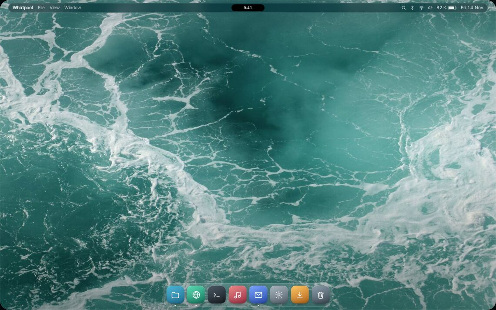

> The images under *Captured from the real build* are photographs of `whirlpool.exe` running on a GitHub-hosted Windows
> runner (`.github/workflows/captures.yml`, 1024x768, 100% scale, no GPU). The renders further down are design renders
> made from the app's palette and layout, not captures.

## Captured from the real build


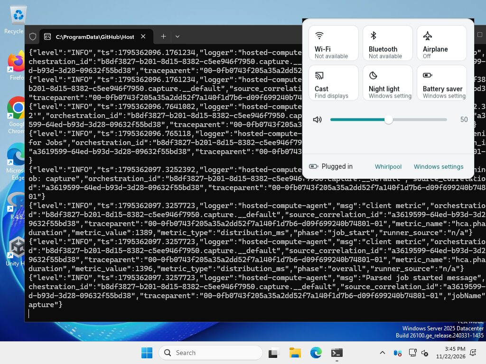
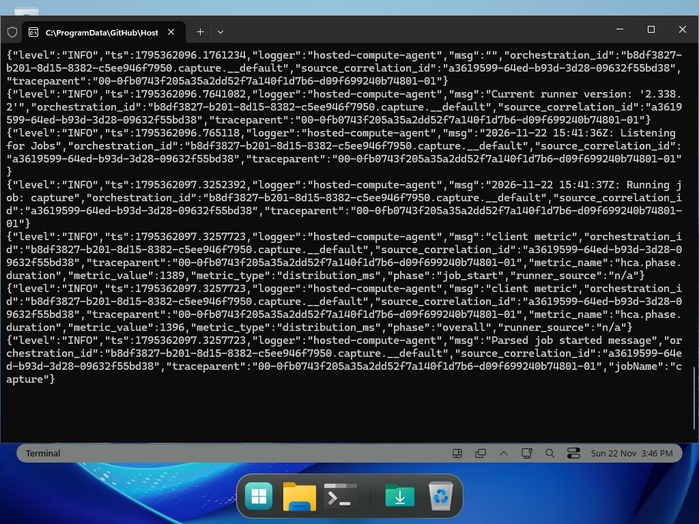

The runner has no radios, so Wi-Fi and Bluetooth read "Not available" there. More captures are in `docs/captures/`.

## What you get

- **Dock** on any edge (bottom, top, left, right) with magnification, genie minimize, live thumbnails, Downloads stack and Recycle Bin.
- **Menu bar** on the top or the bottom edge: docked or floating, three heights, opacity, eleven tints, alignment and width, clock and date options, now-playing and AI plan usage in the island.
- **Six charging animations**: Surge, Halo, Edge, Tide, Bloom, Aurora. Green when healthy, yellow in the middle, orange when low.
- **Motion**: seven speeds from Dreamy to Rapid, and five start-up animations.
- **Fourteen wallpaper photographs** from Pexels, stored in the program (credits in [ASSETS_LICENSES.md](ASSETS_LICENSES.md)).
- **Quick settings** from the bar's network and volume area: Wi-Fi and Bluetooth switches, Airplane mode, volume, Cast, Night light, Battery saver. Colours follow your wallpaper and the Windows theme.
- **System overlay** (hotkey, default Ctrl+Shift+F10): CPU, memory, GPU load, video memory, network, battery and the desktop's frame rate. Three layouts, snaps to corners, drags, click-through. A separate process, so nothing runs while it is hidden. Its frame rate is the compositor's, not the focused game's.
- **Wallpaper rotation**: every 5 minutes to 1 day, in order or shuffled, from a folder or the bundled photographs, a different folder for dark mode, a different picture per display. Off by default.
- **Updates that install**: Settings > System > Updates downloads the release for your CPU, checks its SHA-256, installs and restarts; it can roll back one version. `whirlpool --update` does the same from a terminal.
- **Update reminders**: one Windows notification when a newer release exists, again after three days, three times at most per version. It never downloads or installs on its own, and one switch turns it off.
- **Privacy**: no telemetry; one optional update check ([docs/PRIVACY.md](docs/PRIVACY.md)). **Signing: builds are currently unsigned**, see [SIGNING.md](SIGNING.md).
- **Settings are built in**: `whirlpool.exe --settings`, or launch Whirlpool again while it runs. If OpenGL cannot start, it retries with DirectX.

### Settings


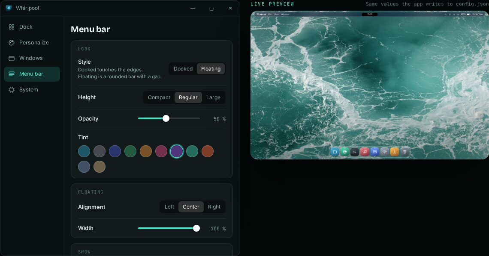
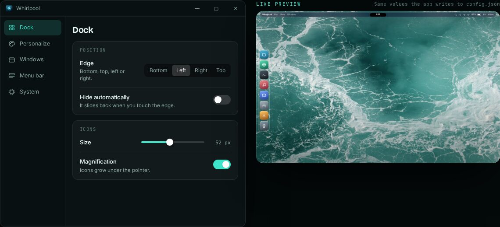

### Wallpapers

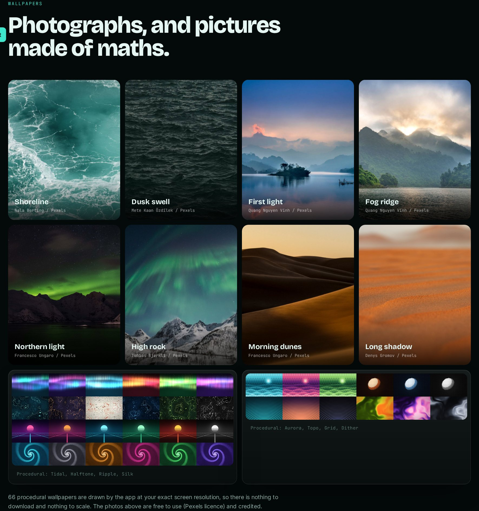

### Charging

| Surge | Halo | Edge |
| --- | --- | --- |
|  |  | 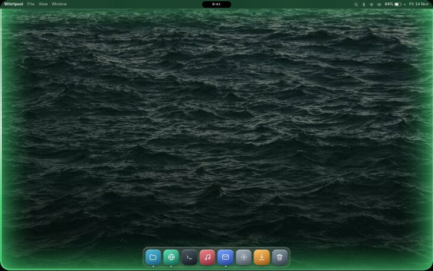 |
| **Tide** | **Bloom** | **Aurora** |
|  | 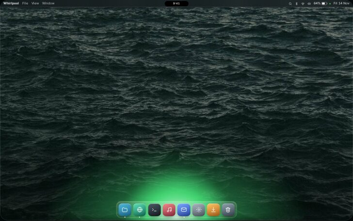 | 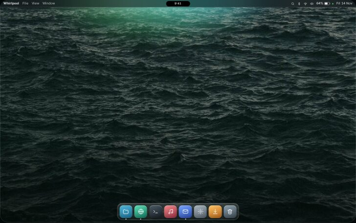 |

### The website

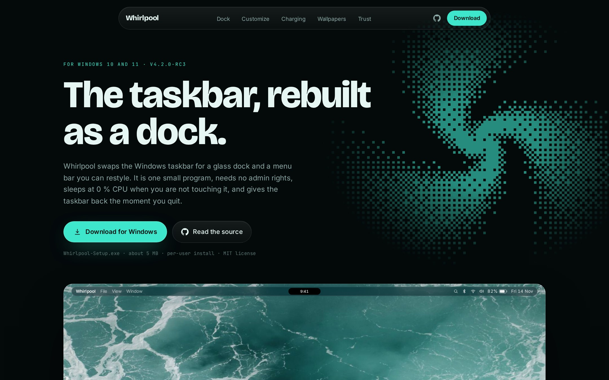
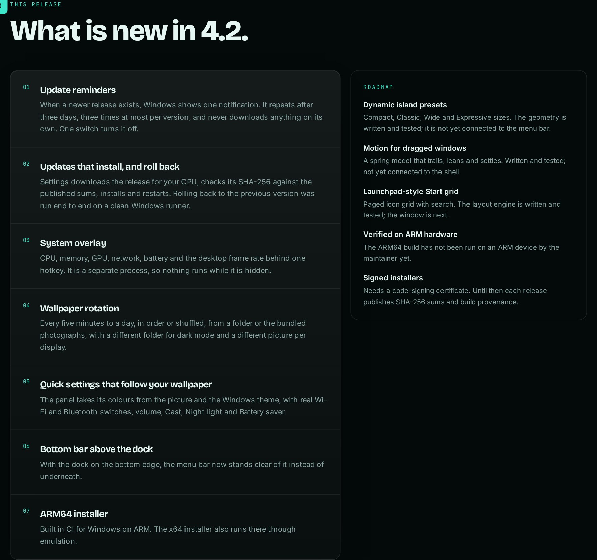

These two are renders of the built site in headless Chromium, not captures of the Windows program.

## Install

1. Download `Whirlpool-Setup.exe` from the [latest release](https://github.com/prashantchataut/whirlpool/releases/latest). It installs per user and needs no administrator rights.
2. If SmartScreen says *Windows protected your PC*: **More info**, then **Run anyway**. New unsigned programs have no reputation yet; see [docs/TRUST.md](docs/TRUST.md).
3. Verify if you like: `Get-FileHash .\Whirlpool-Setup.exe -Algorithm SHA256` against `SHA256SUMS.txt`, or `gh attestation verify Whirlpool-Setup.exe --repo prashantchataut/whirlpool`.

**Windows on ARM:** use `Whirlpool-Setup-arm64.exe`. It is cross-compiled in CI and has not been run on ARM hardware by the maintainer; the x64 installer also runs there through emulation.

**Builds are currently unsigned.** Check a download before running it:

```powershell
(Get-FileHash .\Whirlpool-Setup.exe -Algorithm SHA256).Hash.ToLower()   # must equal the line for Whirlpool-Setup.exe in SHA256SUMS.txt
gh attestation verify .\Whirlpool-Setup.exe --repo prashantchataut/whirlpool   # build provenance
```

Each release's notes link a VirusTotal search for the installer's hash.

Also available: `Whirlpool-x64.zip` (portable) and `install.ps1`. Quit any time from the dock menu, or run `whirlpool.exe --restore` to put the taskbar back.

Requires Windows 10 (1903+) or 11.

## Build

```
git clone https://github.com/prashantchataut/whirlpool
cd whirlpool
cargo run --release -p whirlpool
```

Needs Rust (MSVC) and the Visual Studio C++ build tools. The site is in `site/` (`npm install && npm run build`).

## Status

See [STATUS.md](STATUS.md) for the item-by-item table and [continuity.md](continuity.md) for the hand-off. In short: the updater installs and rolls back (run on a clean Windows runner), the overlay and wallpaper rotation ship, and the bottom bar stands above the dock. Written and unit-tested but **not yet connected to the shell**: dynamic island presets, motion for dragged windows and the Launchpad-style Start grid. Unsigned builds and an ARM64 build that has not run on ARM hardware are listed openly in [SIGNING.md](SIGNING.md) and above.

## License

MIT, (c) 2025-2026 Prashant Chataut ([LICENSE](LICENSE)). Third-party notices are in [NOTICE](NOTICE) and [THIRD_PARTY_LICENSES.md](THIRD_PARTY_LICENSES.md).
