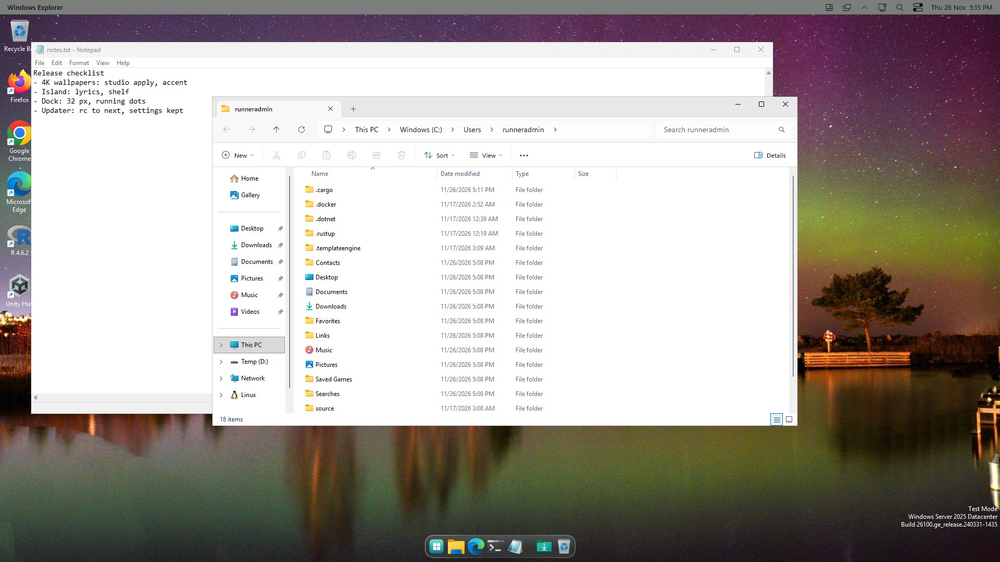
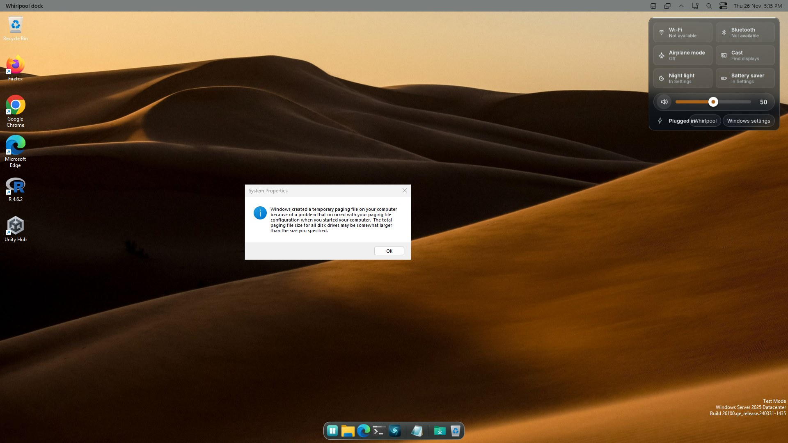
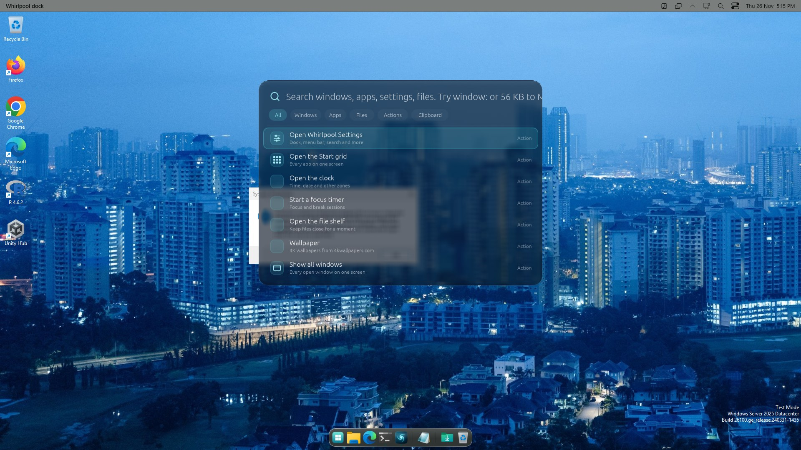
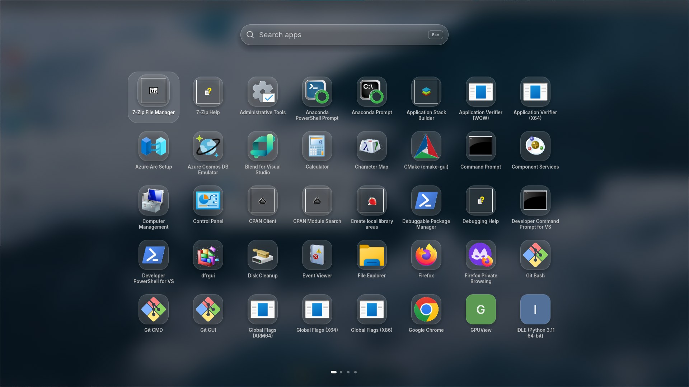
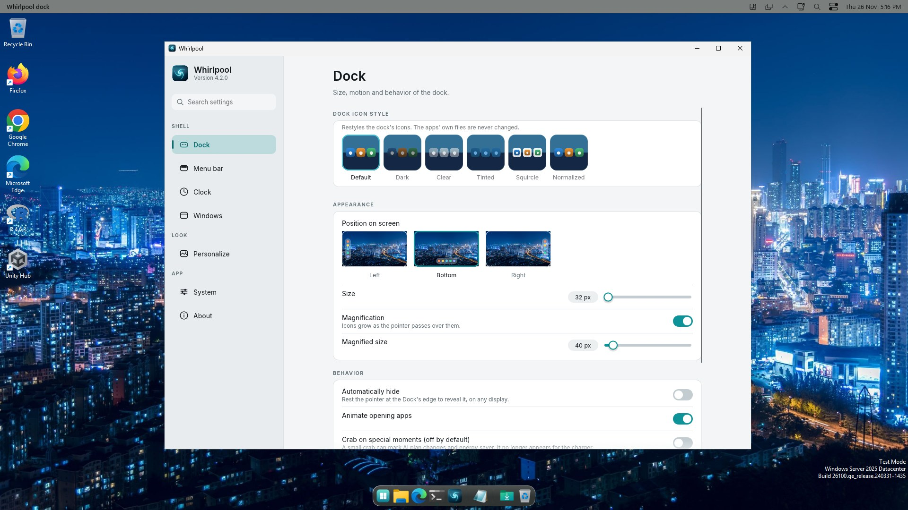

# Whirlpool

The Windows taskbar, rebuilt as a dock. Dock, menu bar and island in one native Rust program.
24 MB idle. No web view, no admin rights. Quit it and the taskbar is back.

[Download](https://github.com/prashantchataut/whirlpool/releases/tag/v4.2.0-rc9) ·
[Site](https://prashantchataut.github.io/whirlpool/) · [Scorecard](SCORECARD.md) · [Changelog](CHANGELOG.md)



Captured from `whirlpool.exe` on a GitHub-hosted Windows runner, 1920×1080, 100 % scale, no GPU. The wallpaper is a
Pexels photograph from the bundled pack; the runner's own terminal is minimised. Not a personal desktop.

| | |
| --- | --- |
|  |  |
| Quick settings, 320 px | `Ctrl+K` palette |
|  |  |
| Start grid | Settings |

## Wallpaper studio

20 pictures in six groups (Abstract, AMOLED, Nature, Minimal, Space, Classics). Apply downloads the 3840×2160 file to
`%LOCALAPPDATA%\Whirlpool\Wallpapers` and sets it with `SystemParametersInfoW(SPI_SETDESKWALLPAPER)`. An optional switch
samples the picture's highlight colour. Open it from Settings, the Wallpaper quick tile, `Ctrl+K`, or `whirlpool --studio`.
`whirlpool --studio-apply ID` applies one from a script.

**Curated 4K wallpapers sourced from [4kwallpapers.com](https://4kwallpapers.com/). Free for personal desktop use.**
Every tile links to its page. No picture is stored in this repository. If the site refuses the download (it has a bot
check), the studio opens the picture's page in your browser instead. Previews and downloads are the only requests, and only
while the studio is open.

## Features

- Dock on any edge: magnification, genie minimize, live thumbnails, 32 px by default.
- Menu bar and island: now playing, opt-in synced lyrics, focus timer, clock. File shelf with drag out.
- Volume, Wi-Fi and Bluetooth pop-ups. The Windows volume flyout is suppressed by a low-level hook that reads only the three volume keys.
- Quick settings, Start grid, window overview, notification centre, hot corners.
- `Ctrl+K` search: apps, files, windows, settings, clipboard, unit conversion, calculator.
- System overlay (`Ctrl+Shift+F10`): CPU, memory, GPU, network, battery, frame rate. Separate process.
- Updater: SHA-256 checked, relaunches, one-version rollback. Update reminders are one toast, three at most.

Feature by feature against a comparable shell: [SCORECARD.md](SCORECARD.md).

## Install

`Whirlpool-Setup.exe` (x64) or `Whirlpool-Setup-arm64.exe` from the [release](https://github.com/prashantchataut/whirlpool/releases/tag/v4.2.0-rc9). Per user, no admin. Portable zips and `SHA256SUMS.txt` are on the same page.
Builds are unsigned ([SIGNING.md](SIGNING.md)). ARM64 is built in CI and has not run on ARM hardware. Windows 10 1903+ or 11.

```powershell
(Get-FileHash .\Whirlpool-Setup.exe -Algorithm SHA256).Hash.ToLower()   # compare with SHA256SUMS.txt
```

## Build

```
git clone https://github.com/prashantchataut/whirlpool
cd whirlpool && cargo run --release -p whirlpool
```

Needs Rust (MSVC) and the Visual Studio C++ build tools. Site: `site/` (`npm install && npm run build`).

## Not done

Signed installers, a personal-desktop run, ARM hardware, spectrum bars in the island, a desktop widget layer, per-app volume,
game auto-hide, the 200 % scale pass. [STATUS.md](STATUS.md) has the rest.

MIT. Photographs: [ASSETS_LICENSES.md](ASSETS_LICENSES.md). Privacy: [docs/PRIVACY.md](docs/PRIVACY.md).
