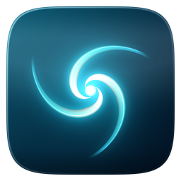
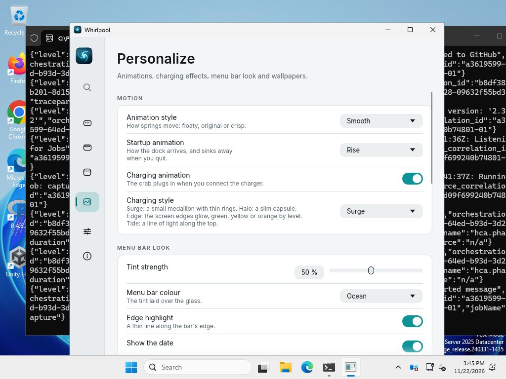
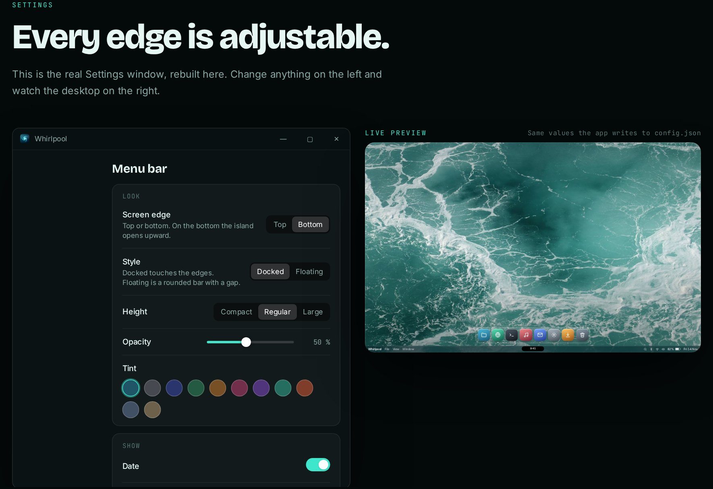
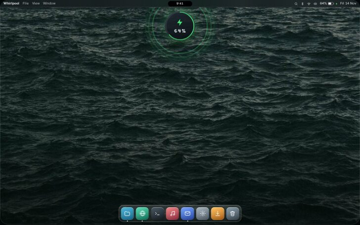
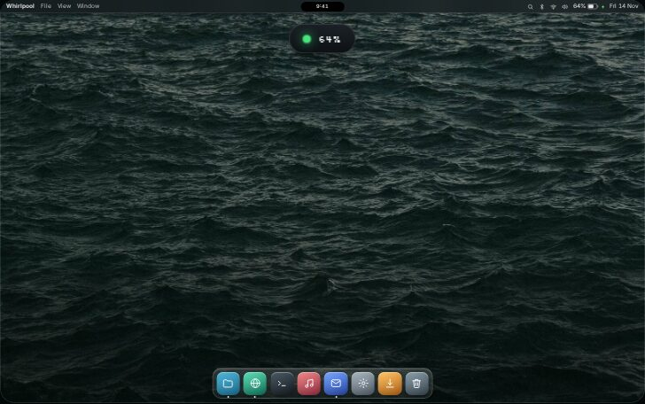
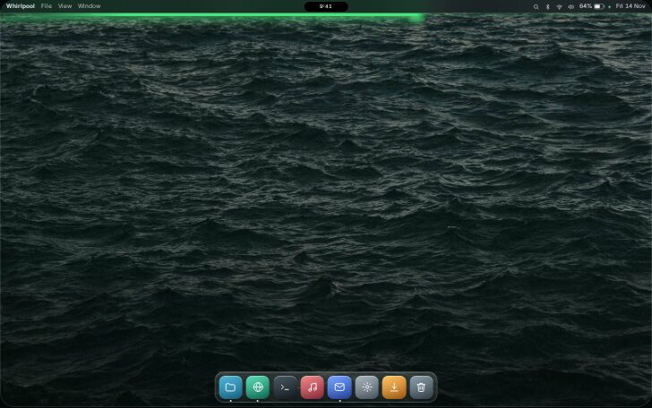

<p align="center"></p>

# Whirlpool

**The Windows taskbar, rebuilt as a dock.** A glass dock and a menu bar you can restyle, in one small native program.
No web view, no runtime, no admin rights. It sleeps at 0 % CPU when idle, and the taskbar comes back when you quit.

[**Download**](https://github.com/prashantchataut/whirlpool/releases/latest/download/Whirlpool-Setup.exe) ·
[Website](https://prashantchataut.github.io/whirlpool/) · [Changelog](CHANGELOG.md) · [Trust](docs/TRUST.md)


> The images under *Captured from the real build* are photographs of `whirlpool.exe` running on a GitHub-hosted Windows
> runner (`.github/workflows/captures.yml`, 1024x768, 100% scale, no GPU). The renders further down are design renders
> made from the app's palette and layout, not captures.

## Captured from the real build




The runner has no radios, so Wi-Fi and Bluetooth read "Not available" there. More captures are in `docs/captures/`.

## What you get

- **Dock** on any edge (bottom, top, left, right) with magnification, genie minimize, live thumbnails, Downloads stack and Recycle Bin.
- **Menu bar** on the top or the bottom edge: docked or floating, three heights, opacity, eleven tints, alignment and width, clock and date options, now-playing and AI plan usage in the island.
- **Six charging animations**: Surge, Halo, Edge, Tide, Bloom, Aurora. Green when healthy, yellow in the middle, orange when low.
- **Motion**: seven speeds from Dreamy to Rapid, and five start-up animations.
- **Fourteen wallpaper photographs** from Pexels, stored in the program (credits in [ASSETS_LICENSES.md](ASSETS_LICENSES.md)).
- **Quick settings** from the bar's network and volume area: Wi-Fi and Bluetooth switches, Airplane mode, volume, Cast, Night light, Battery saver.
- **Privacy**: no telemetry; one optional update check ([docs/PRIVACY.md](docs/PRIVACY.md)). **Signing**: not signed yet, see [SIGNING.md](SIGNING.md); SmartScreen reputation builds over time with signed, widely downloaded releases.
- **Settings are built in**: `whirlpool.exe --settings`, or launch Whirlpool again while it runs. If OpenGL cannot start, it retries with DirectX.

### Settings




### Wallpapers


### Charging

| Surge | Halo | Edge |
| --- | --- | --- |
|  |  |  |
| **Tide** | **Bloom** | **Aurora** |
|  |  |  |

## Install

1. Download `Whirlpool-Setup.exe` from the [latest release](https://github.com/prashantchataut/whirlpool/releases/latest). It installs per user and needs no administrator rights.
2. If SmartScreen says *Windows protected your PC*: **More info**, then **Run anyway**. New unsigned programs have no reputation yet; see [docs/TRUST.md](docs/TRUST.md).
3. Verify if you like: `Get-FileHash .\Whirlpool-Setup.exe -Algorithm SHA256` against `SHA256SUMS.txt`, or `gh attestation verify Whirlpool-Setup.exe --repo prashantchataut/whirlpool`.

Also available: `Whirlpool-x64.zip` (portable) and `install.ps1`. Quit any time from the dock menu, or run `whirlpool.exe --restore` to put the taskbar back.

Requires Windows 10 (1903+) or 11.

## Build

```
git clone https://github.com/prashantchataut/whirlpool
cd whirlpool
cargo run --release -p whirlpool
```

Needs Rust (MSVC) and the Visual Studio C++ build tools. The site is in `site/` (`npm install && npm run build`).

## Status

See [continuity.md](continuity.md) for what is verified, what is not, and what is next. The bottom bar standing above the dock is confirmed in a runner capture; popups on a bottom bar and multi-monitor are still untested. An FPS and system-info overlay, a full dynamic island with presets and motion for dragged windows are planned, not shipped.

## License

MIT, (c) 2025-2026 Prashant Chataut ([LICENSE](LICENSE)). Third-party notices are in [NOTICE](NOTICE) and [THIRD_PARTY_LICENSES.md](THIRD_PARTY_LICENSES.md).
