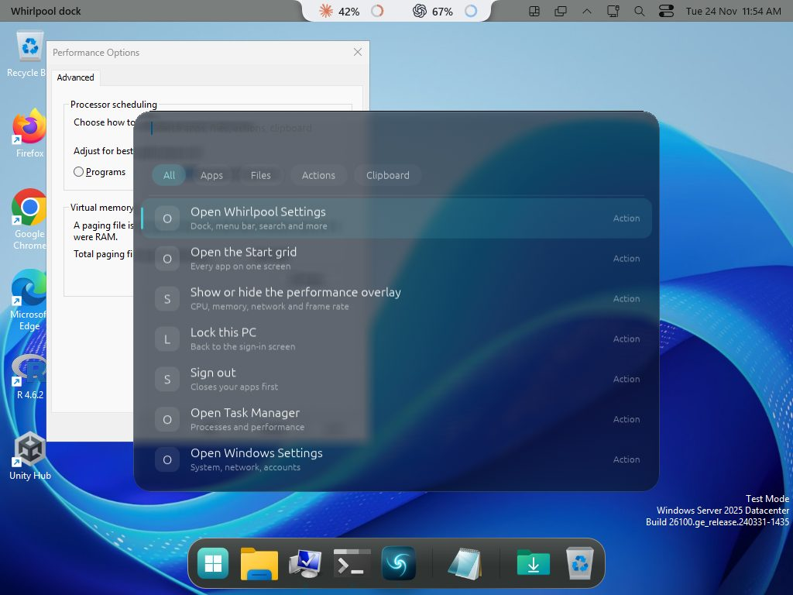
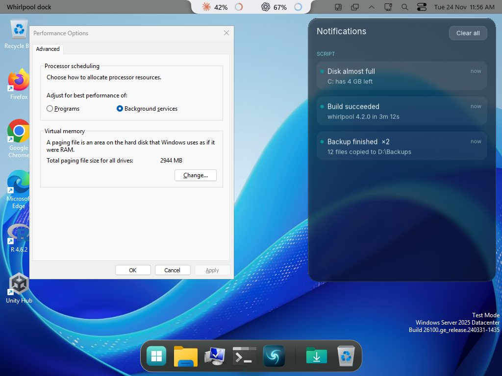
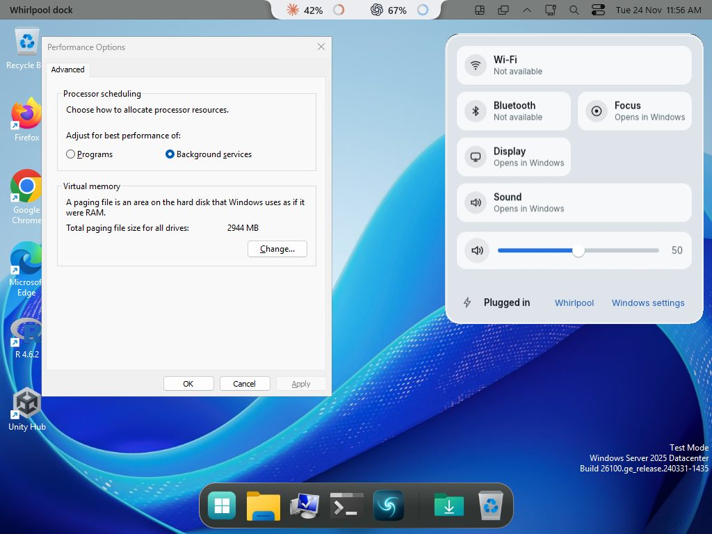
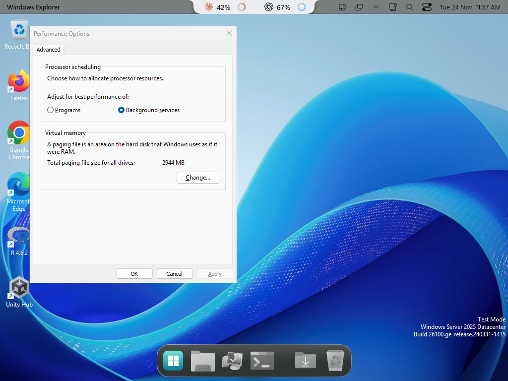

# Study: Whirlpool next to a reference desktop shell

Black-box only. Both programs ran on a GitHub `windows-latest` runner (1024x768, no GPU, no OpenGL 2.0, so every
panel used the software DirectX fallback) and were driven with real mouse and keyboard input; the driver measured
what the screen and the process table showed. No file of the reference was decompiled, disassembled, read for code,
text or art, or copied. Its name stays out of this repository: it is "the reference" below. Its frames were kept in a
private artifact that expires after one day, and **this file publishes numbers and Whirlpool's own frames only**. That
is a deliberate departure from "side-by-side captures": the reference's frames contain another company's names and
icons, which Whirlpool must not carry. Harness: `scripts/study.ps1`, `scripts/observe-install.ps1`,
`.github/workflows/study.yml` (the program under study is supplied through repository secrets).

## Session 7 re-run (latest release of the reference; one run per program)

Same harness on fresh runners (run 45408962749). Numbers only.

| Measure | Reference | Whirlpool (main) | Whirlpool (this branch) |
| --- | --- | --- | --- |
| Idle working set | 252.9 MB | 12.8 MB | 12.6 MB |
| Idle private memory | 135.1 MB | 23.9 MB | 24.4 MB |
| Idle CPU (one core) | 5.39 % | 0.08 % | 0.04 % |
| Processes at idle | 5 | 2 | 2 |
| Exit (quit to no process) | 316 ms | 1118 ms | 1070 ms |
| First visible change after launch | 206 ms | not rerun | 475 ms |
| Settled after launch | 5851 ms | not rerun | 502 ms |
| Start grid by hotkey: first change / settled | 43 ms / 1557 ms (one chord reacted) | not rerun | 193 ms / 2103 ms (includes the software DirectX start) |
| Task overview | Win+Tab (Windows' own): 38 ms / 190 ms | not rerun | own overview: 200 ms ease-out once its process is up (not timed from the key on the runner) |

Panel memory (this branch, runner without a GPU): start grid open 335.5 MB private, palette 332.0, quick settings 297.5; after closing 24.2, 23.4, 23.4.
Main: 314.4, 329.4, 298.7 open; 24.8, 24.7, 24.6 closed. **No memory change this session**; item 7 stays PARTIAL.

The reference ignored most keys I tried (its shortcuts are unknown to me), so those scenes are "not measured", not "absent". It exits faster than
Whirlpool; that is a real gap. The window overview is now **done** (`docs/captures/session7/`).

### Ranked gaps after session 7

1. Panels cost about 300 MB open without OpenGL and start in about 7 s there.
2. Overview: no app icons in captions; no hotkey or Settings card of its own.
3. Exit takes about 1.1 s against 0.3 s.
4. No file preview on Space; no window grouping view.
5. Palette repeats "Action" on every action row.
6. Notification history holds only Whirlpool's and scripts' alerts.
7. Hot-corner dwell uses a 120 ms timer while a corner is set.
8. The feature name "Launchpad" in code and Settings.

## What this study could not do

- I did not look at the reference's frames in this session. Its rows below come from the driver's numbers (pixel
  change, latency, settle time) and from its public documentation, which I used only to know what to look for.
- Many of the keys I tried on the reference changed nothing (`change` of about 0.05 means no visible reaction): I did
  not know its shortcuts. Those scenes are **not measured**, not "absent".
- Timing is sampled at about 35 frames per second on a software-rendered VM: it shows order of magnitude and easing
  direction, not frame-exact curves. Latency includes the runner's input delay.
- One run per program. No variance is reported.

## Measured: resources

| Measure | Reference | Whirlpool (main, before) | Whirlpool (this branch) |
| --- | --- | --- | --- |
| Idle working set | 254 MB | 12.9 MB | 13.2 MB |
| Idle private memory | 134 MB | 22.5 MB | 22.8 MB |
| Idle CPU (share of one core) | 5.23 % | 0.00 % | 0.00 % |
| Processes at idle | 5 | 2 | 2 |
| Exit (quit command to no process) | 1132 ms | 708 ms | 1107 ms |
| First visible change after launch | 222 ms | 443 ms | 471 ms |
| Settled after launch | 5576 ms | 773 ms | 791 ms |

Install (reference only, observed from outside): 8.5 s, 2324 files, 217.5 MB; its uninstaller ran for 0.5 s and the
program folders (2324 files, 217.5 MB) were still on disk afterwards. Whirlpool's install log and clean uninstall
are covered in `STATUS.md` (item 6).

## Measured: scenes both programs reacted to

| Scene | Trigger used | Reference | Whirlpool (this branch) |
| --- | --- | --- | --- |
| Menu bar icon row | click at six x positions | 126 to 599 ms to settle, easing slow at the start (9 / 23 / 49 % of the change at 25 / 50 / 75 % of the time) | quick settings 147 ms, search 1 frame (instant), window overview 1 frame |
| Dock hover | pointer along the dock | not triggered by my path (change 0.45) | 95 to 271 ms, slow at the start (0 / 21 / 39 %) |
| Start grid | hotkey | one hotkey changed the screen: 1710 ms to settle | 2302 ms (includes the 7 s DirectX fallback start on this runner before the first frame) |
| Hot corners | pointer in each corner, 1 s | no reaction in any corner (change below 0.3) | all four corners are configurable; top-left and top-right fired on real pointer input (`13-corner-*` captures) |
| Task overview | Win+Tab | 190 ms | opens Windows Task View |

## Feature table (what each side offers; the reference column comes from its public documentation and is not verified)

| Area | Reference | Whirlpool before | Whirlpool now |
| --- | --- | --- | --- |
| Magnifying dock, running dots, stacks | yes | magnifier and dots; no stacks | unchanged |
| Dock icon styles (default, dark, clear, tinted) | yes | none | **done**: Settings, Dock, with live preview |
| Glass with refraction | yes (GPU) | flat blur | **done** in our own CPU shader: search and notification panels, Settings preview |
| Command palette (apps, files, actions, clipboard) | yes | none | **done** (previous commits on this branch) |
| Quick settings | fixed grid | six fixed tiles | **done**: editable grid (drag, resize, add, remove) |
| Notification centre with history | yes, for other apps' alerts | Windows' own flyout only | **partly**: history of Whirlpool's and scripts' alerts; other programs' toasts cannot be read without a packaged identity |
| Hot corners | yes | none | **done** (eight actions per corner, never over full-screen) |
| Window overview | own full-screen view | Task View button | **not done**: hot corner and bar open Windows Task View |
| File preview on Space | yes | none | not done |
| Window grouping view | yes | none | not done |
| Start window | own grid | grid (merged earlier), now with Settings preview | done |
| Title bars injected into other apps | yes | none | skipped on purpose (antivirus, RAM) |
| Replaced message boxes, bundled mini-apps | yes | none | skipped on purpose |
| Memory | about 134 MB private idle | 22 MB | 22 MB idle, see the honest note in `STATUS.md` |

## Ranked gaps in Whirlpool

1. **Panels cost about 300 MB while open on a machine without OpenGL** (every panel: grid, search, quick settings,
   notifications). Idle is 23 MB, but a panel process on the software renderer reaches 297 to 333 MB private, for a
   few seconds. On a GPU machine this is probably much less; not measured.
2. **Panel start time without OpenGL**: about 7 s (a failed OpenGL attempt, then a second process on DirectX). Needs a
   decision about trying DirectX first on machines where OpenGL is known to fail (it is remembered after the first
   failure, `remember_compat`).
3. **No window overview of our own** (live thumbnails of every window). Large; DWM thumbnails are the route.
4. **No file preview** (Space on a selected file).
5. **No window grouping view.**
6. **Palette polish**: action icons are letters in circles; the placeholder is hard to read over a busy backdrop (seen
   in `docs/captures/session5/08-palette-open.jpg`).
7. **Notification history only holds Whirlpool's and scripts' alerts.**
8. **Hot-corner dwell uses a 120 ms timer** while any corner is set; a mouse hook would cost nothing between moves
   but needs a hook thread (rejected for now: antivirus).
9. **Existing feature names** ("Launchpad") look like another company's product name; renaming is pending.

Where Whirlpool is ahead, measured: idle memory (about 6 times smaller), idle CPU (none), processes (2 against 5) and
settle time after launch.

## Captures (Whirlpool only, from the runner)

